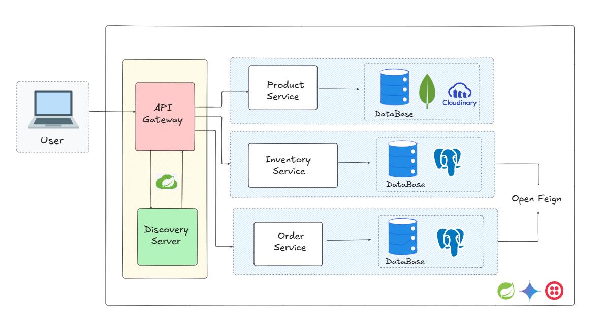

# 🛒 E-Commerce Microservices Backend

## 🌟 Project Overview

This backend powers an online shopping system where users can add and manage products, upload product images, and place orders easily. It automatically checks if items are in stock before confirming an order and updates availability in real time. The system can also answer simple questions about products using AI, and it is designed to handle multiple users smoothly by organizing different tasks like products, inventory, and orders into separate parts that work together seamlessly.


## 🏗️ Architecture Diagram

<p align="center">
  
</p>

## Microservices Breakdown

### 1. API Gateway

**Purpose**

Acts as the single entry point for client requests and provides a cleaner edge layer for the system.

**Responsibilities**

- routes incoming requests to downstream services
- hides internal service URLs from clients
- simplifies future cross-cutting concerns such as authentication, rate limiting, and logging

### 2. Discovery Server

**Purpose**

Provides a centralized service registry using **Netflix Eureka** so services can discover each other dynamically in a distributed setup.

**Responsibilities**

- service registration
- service discovery
- foundation for resilient microservice communication

### 3. Product Service

**Purpose**

Owns the product catalog domain and exposes APIs to create, update, fetch, and enrich products.

**Responsibilities**

- product CRUD operations
- partial product updates using JSON Patch
- product image upload handling
- AI-powered product query responses

**Integrations**

- **Cloudinary** for product image hosting
- **Gemini AI** for product-aware customer questions
- **MongoDB** for flexible catalog storage

### 4. Inventory Service

**Purpose**

Maintains stock accuracy and protects inventory consistency during ordering flows.

**Responsibilities**

- add and track product stock
- reserve stock during order creation
- release stock when an order is cancelled or expires
- confirm reserved stock when an order is finalized
- schedule cleanup for expired reservations

**Integrations**

- **PostgreSQL** for transactional inventory records

### 5. Order Service

**Purpose**

Handles the order lifecycle and coordinates with other services to validate and reserve inventory.

**Responsibilities**

- create orders
- update order state through business lifecycle stages
- cancel unpaid orders
- communicate with downstream services using OpenFeign

**Integrations**

- **Inventory Service** for stock reservation and release
- **Product Service** for product-aware order orchestration
- **PostgreSQL** for order persistence
- **Twilio-ready notification layer** for order-status messaging use cases

## Tech Stack

- Java 21
- Spring Boot 3
- Spring Cloud
- Spring Cloud Gateway
- Eureka Discovery Server
- REST API
- OpenFeign
- MongoDB
- PostgreSQL
- Cloudinary
- Google Gemini AI
- Twilio-ready SMS integration
- Maven
- Postman
- Docker-friendly structure

## 🔌 Key Integrations

### Cloudinary

The **Product Service** uploads product images to Cloudinary and stores back the hosted image URL and public image ID. This removes the burden of local file handling and makes media delivery more production-friendly.

### Gemini AI

The **Product Service** uses Gemini to answer natural-language questions about a product. It dynamically builds a prompt using product name, price, and description, then returns an AI-generated response that can power smart product exploration experiences.

### Twilio

This project is architected with a clear notification use case around **order updates and customer communication**. The current codebase is already split in a way that makes **Twilio SMS integration a natural extension point** inside the order workflow layer.

## 🔄 Inter-Service Communication Flow

### Product Management Flow

1. Client sends a product request through the API Gateway or directly to the Product Service.
2. Product data is stored in MongoDB.
3. Product images are uploaded to Cloudinary.
4. Product-specific customer questions are answered through Gemini AI.

### Order Placement Flow

1. Client submits an order request to the Order Service.
2. Order Service creates an order in `CREATED` state.
3. Order Service calls Inventory Service using OpenFeign.
4. Inventory Service reserves stock if quantity is available.
5. Order status moves to `RESERVED` when stock reservation succeeds.
6. If an order is cancelled, reserved stock is released back into inventory.
7. If payment/final confirmation succeeds, Inventory Service confirms the reservation and the order can progress toward completion.

## Project Structure

```text
e-commerce/
├── api-gateway/
├── discovery-server/
├── product-service/
├── inventory-service/
├── order-service/
└── pom.xml
```

## 🚀 Installation & Setup

### Prerequisites

- Java 21
- Maven or Maven Wrapper
- MongoDB
- PostgreSQL
- Postman
- Cloudinary account
- Gemini API key

### Environment Configuration

For a production-style setup, externalize sensitive values through environment variables or secret management instead of committing them into properties files.

Suggested configuration values:

- `SPRING_DATA_MONGODB_URI`
- `SPRING_DATA_MONGODB_DATABASE`
- `SPRING_DATASOURCE_URL`
- `SPRING_DATASOURCE_USERNAME`
- `SPRING_DATASOURCE_PASSWORD`
- `MEDIA_CLOUDINARY_CLOUD_NAME`
- `MEDIA_CLOUDINARY_API_KEY`
- `MEDIA_CLOUDINARY_API_SECRET`
- `AI_GEMINI_API_KEY`
- `TWILIO_ACCOUNT_SID`
- `TWILIO_AUTH_TOKEN`
- `TWILIO_FROM_NUMBER`

### Run Order

Start the services in the following order:

1. Discovery Server
2. API Gateway
3. Product Service
4. Inventory Service
5. Order Service

### Local URLs

| Component | URL |
| --- | --- |
| Eureka Dashboard | `http://localhost:8761` |
| API Gateway | `http://localhost:8080` |
| Product Service | `http://localhost:8081` |
| Inventory Service | `http://localhost:8082` |
| Order Service | `http://localhost:8083` |

## 📡 API Endpoints Overview

### API Gateway

| Method | Endpoint | Description |
| --- | --- | --- |
| `ANY` | `/product/**` | Routes product requests to `product-service` |
| `ANY` | `/inventory/**` | Routes inventory requests to `inventory-service` |
| `ANY` | `/order/**` | Routes order requests to `order-service` |

### Product Service

| Method | Endpoint | Description |
| --- | --- | --- |
| `POST` | `/api/v1/products/upload-image` | Upload product image to Cloudinary |
| `POST` | `/api/v1/products/add-product` | Create a new product |
| `GET` | `/api/v1/products` | Fetch all products |
| `GET` | `/api/v1/products/{id}` | Fetch a product by ID |
| `PUT` | `/api/v1/products/{id}` | Fully update a product |
| `PATCH` | `/api/v1/products/{id}` | Partially update a product using JSON Patch |
| `POST` | `/api/v1/products/{id}/query?customerQuery=...` | Ask Gemini AI a product-related question |

### Inventory Service

| Method | Endpoint | Description |
| --- | --- | --- |
| `POST` | `/api/v1/inventory/add-stock` | Add stock for a product |
| `GET` | `/api/v1/inventory/stock/{id}` | Get stock details for a product |
| `POST` | `/api/v1/inventory/reserve-stock` | Reserve stock for an order |
| `POST` | `/api/v1/inventory/release-stock/{id}` | Release reserved stock |
| `POST` | `/api/v1/inventory/confirm-order/{orderId}` | Confirm reserved stock for a completed order |
| `DELETE` | `/api/v1/inventory/stock/{id}` | Remove stock record |

### Order Service

| Method | Endpoint | Description |
| --- | --- | --- |
| `POST` | `/api/v1/orders` | Place a new order |
| `POST` | `/api/v1/orders/{orderId}` | Cancel an existing unpaid order |

## What This Project Demonstrates

- built an e-commerce backend using Spring Boot microservices.
- created an API Gateway to route requests.
- set up Eureka for service discovery.
- built a Product Service for product CRUD and image uploads.
- integrated Cloudinary for image storage.
- integrated Gemini AI for product-related questions.
- built an Inventory Service to manage stock.
- built an Order Service to handle orders.
- used MongoDB for products and PostgreSQL for transactional data.
- connected the services using REST and OpenFeign.

## Conclusion

This project shows my work on a Spring Boot microservices-based e-commerce backend with service routing, product management, inventory handling, and external integrations.


